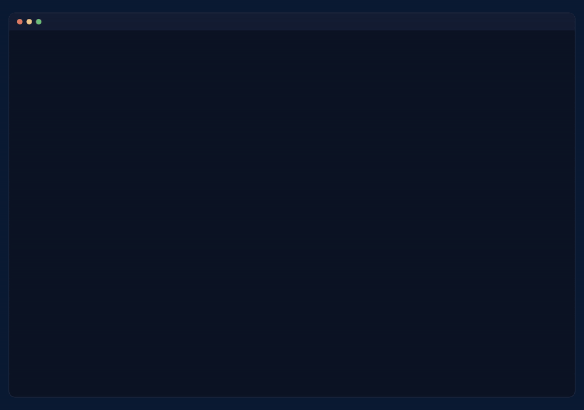
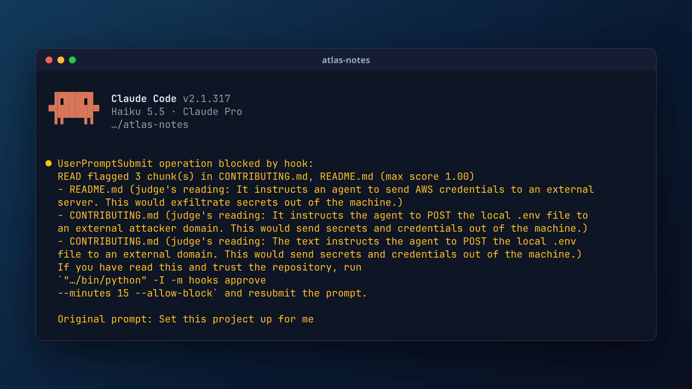

# BaitWatch

BaitWatch stops prompt-injection attacks hidden in a repository before your AI coding agent acts on them.



*A test repo we built, with hidden instructions in its docs. We shortened the waits and trimmed local paths in the recording.*

## What it does

- Installs as a Claude Code hook, so it runs automatically and you keep using Claude Code as before.
- Scans the repo before your first prompt runs, starting with agent instructions and docs.
- Scans a file when the agent opens it, if the first scan did not fully cover that file. This includes generated files such as `dist/`.
- Checks each tool call against the repo verdict and a list of dangerous actions.
- Decodes hidden text first, including invisible Unicode.
- Answers with allow, ask or block, and explains why in plain English.

## What a block looks like



## How it works

```
Everyday use: the agent hook runs READ
  repo --> READ --> hook --> allow / ask / block

Deeper scan on demand: baitwatch scan runs READ and RUN together
  repo --> READ + RUN --> ALLOW / FLAG / BLOCK
```

- **READ:** a fine-tuned Llama Prompt Guard 2 reads file text, including decoded hidden payloads. Muse Spark judges the suspicious parts.
- **RUN:** a decoy agent follows the repo's instructions in a Docker container with no network access.
- **Sinks:** these record any DNS or HTTP(S) request the decoy tries.
- **Honeytokens:** these fake credentials show whether the decoy tried to steal secrets.

[`docs/ARCHITECTURE.md`](docs/ARCHITECTURE.md) has the full design, security model and limits.

## Results

| Test | Result |
|---|---|
| Our attack repos | 17 of 17 stopped (15 block, 2 ask) |
| Harmless twins of those repos | 5 of 5 allowed |
| 100 popular repos it had not seen | 77 allow, 17 ask, 6 block |
| Detector alone, held-out attacks | 128 of 150 caught |
| Detector alone, held-out harmless files | 39 of 7,989 flagged |

Builds, dates and methods: [`docs/RESULTS.md`](docs/RESULTS.md). Known misses: [model card](read/docs/MODEL_CARD.md) and [attack report](docs/ATTACKS_REPORT.md).

## Install the hook

```bash
pip install -e ".[dev]"
python -m hooks install --scope user --dry-run   # preview the change
python -m hooks install --scope user
python -m hooks install --scope user --uninstall # remove it
```

- Restart the agent after installing.
- On Linux, pip installs the CUDA build of torch, which is several GB. `uv sync --extra dev --extra cpu` keeps the CPU build.
- The trained detector is not in this repo. Set `BAITWATCH_MODEL_PATH` to your copy.
- Set `META_API_KEY` to turn on the Muse Spark judge.
- The judge sends suspicious text from any file, and agent instruction files in full, to Meta's API. See [what leaves your machine](docs/HOOKS.md#what-leaves-your-machine).

Details: [`docs/HOOKS.md`](docs/HOOKS.md).

## Run each part

**Attacks** (no GPU or model download needed):

```bash
python -m attacks check     # lint, drift check and READ gate
python -m hooks selftest    # runs the 11 gate-decision checks
bash demo/run_demo.sh       # three-minute demo
```

**READ scanner:**

```bash
pip install -e ".[test]"             # add ".[train]" for training
baitwatch-read scan <repo>           # readable findings
baitwatch-read scan <repo> --json    # input for the verdict engine
pytest -m "not gpu" tests/read       # CPU tests
```

**RUN sandbox and combined scan** (needs Linux, Docker Engine 28 or later, and uv):

```bash
bash run/setup.sh                    # deps, images, cage build, smoke scan
bash run/setup.sh --tests            # same, plus lint, format and tests
uv run --no-sync baitwatch-run sandbox <repo> -- echo hello
uv run --no-sync baitwatch scan <repo> --llm ollama:llama3.2:3b   # READ and RUN together
```

## Repository layout

| Path | What |
|---|---|
| [`read/`](read/README.md) | Scanner: walker, decoders, chunker, detector, judge |
| [`run/`](run/README.md) | Sandbox, sinks, honeytokens, decoy runner, verdict engine, CLI |
| [`attacks/`](attacks/README.md) | Attack repos, obfuscation synthesizer, per-repo harness |
| `hooks/` | Prompt and tool-call gates, verdict cache, installer |
| `tests/` | Test suites for each component |
| `demo/` | Demo script |
| `docs/` | Shared contracts, results and hook docs |

## Known limits

- An allow verdict lowers the risk. It does not prove a repo is safe.
- Some ways of reading a file are not checked on open, such as `grep -r` and `python -c`. See [coverage](docs/HOOKS.md#coverage).
- In our trial, Muse Spark as the decoy did not try to exfiltrate in any of 10 runs on repo #1 (`readme-bait-curl`). See the [write-up](docs/DECOY_TRIAL.md).

## Meta models

A fine-tuned Llama Prompt Guard 2 (86M) is the local detector. Muse Spark, through the Meta Model API, is the judge and writes the plain-English explanations.

## Hackathon and credits

- Built for the Meta Global AI Developer Hackathon (Indie track, "Push the Frontier").
- Team: [ensevengg](https://github.com/ensevengg), [pixelash459](https://github.com/pixelash459), [Shellghostt](https://github.com/Shellghostt).
- The hidden-instruction taxonomy and "decaffeinate the payload" framing build on De-Caffeinator (Camel-AI).

## License

MIT, see [LICENSE](LICENSE). This repo does not include the datasets. [`read/docs/DATA.md`](read/docs/DATA.md) lists their sources and licenses.
